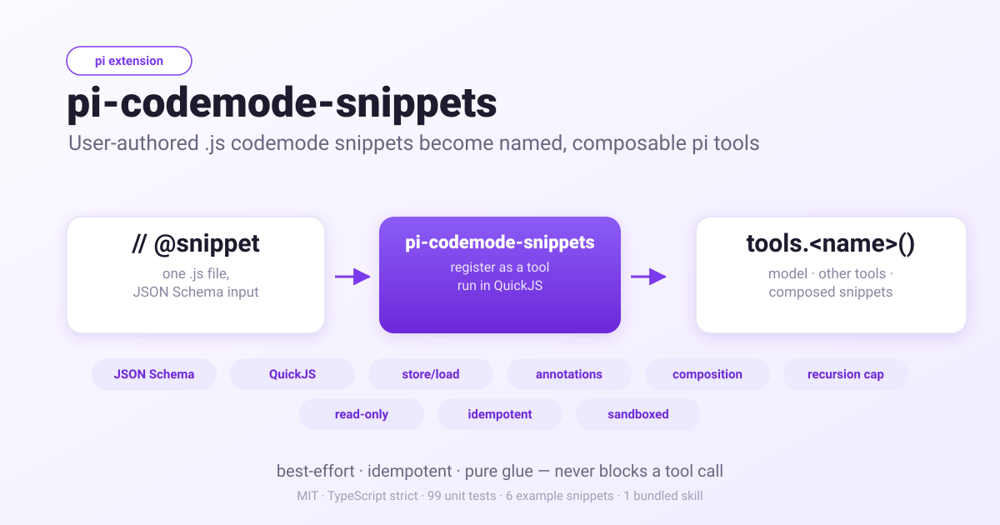

# pi-codemode-snippets

[English](../README.md) | 简体中文

<p align="center">
  
</p>

[](../LICENSE)
[](https://www.npmjs.com/package/pi-codemode-snippets)
[](https://github.com/tychenjiajun/pi-codemode-snippets/releases/latest)
[](https://pi.dev/docs/latest/extensions)
[](https://pi.dev/docs/latest/packages)
[](../tsconfig.json)
[](../package.json)
[](https://pnpm.io)

**pi-codemode-snippets** 把用户编写的 JavaScript 文件变成一等的
[pi](https://github.com/earendil-works/pi) 工具。每个文件都是一段已保存的
[`codemode`](https://github.com/earendil-works/pi/blob/main/packages/coding-agent/docs/codemode.md)
脚本，外加一条小小的元数据注释。这样，你在会话中运行过、觉得有用的脚本，就能变成一个具名工具：
模型可以调用它，其他工具可以调用它，其他代码段也可以组合调用它。

它是 Code Mode 的“保留值得保留的脚本”那一半。Code Mode 给模型提供了一个沙箱；
本扩展则给你一套 durable、可评审、可版本管控的常用脚本库。

> **一句话概括：** 一条 `// @snippet:` 注解 + 一条 `.js` 文件的约定，就能把磁盘上的
> 任意 codemode 脚本注册为命名工具 — 拥有 JSON Schema 输入校验、QuickJS 沙箱、
> 嵌套调用权限管控、用量记账和跨代码段组合能力 —— 而无需发明新语言或新运行时。

## 为什么需要代码段

没有本扩展，你的 codemode 脚本是**临时**的。这些是见于真实 pi 会话中的问题：

- **脚本在一次运行后就消失。** 模型写了一段 60 行的 PR  triage 脚本，等到下一次
  会话它就没了；如果让模型“记住它”，它会重新写一遍，每次还会细微错开。
- **没有可复用的名字。** 你一遍又一遍地把 `gh pr list` 的正文复制到新脚本里，
  而不是直接叫出“那个列表 PR 的工具”。
- **无法组合，没有 DRY 库。** 需要“获取后再总结”的脚本会重复写获取逻辑，
  而不是复用你已经写好的列表工具。
- **临时工具背离规范。** 每轮都给模型一个全新的内联脚本，模型就会重复武曲地
  重新编写相同逻辑，而不是调用一个稳定、已评审的具名工具。

`pi-codemode-snippets` 用一条规则解决全部问题：**代码段文件就是 codemode 脚本** ——
只多了一个名字和注册。模型、其他工具，以及其他代码段都通过这个名字调用它，
而且因为正文是原汁原味的 codemode JavaScript，并不需要学习任何额外语义。

## 它做了什么

- 从用户、项目和设置三个代码段目录中发现每 `.js` 文件作为一个工具。
- 把文件头的 `// @snippet:`（或 `/* @snippet:` 块）注解当作 JSON 元数据，
  并用 `input` JSON Schema 注册每个文件为 pi 工具。
- 把正文交给 pi 内置的 `codemode` 执行器运行 —— 所以代码段保留 QuickJS 沙箱、
  `tools.*`、`store`/`load`、`models`、嵌套调用权限（`parentToolCallId`）
  和用量记账，其他什么都不用改。
- 支持代码段调用代码段，嵌套深度默认上限为 10。
- 提供 `/snippet list | show | validate | preview` 命令，在不执行任何代码的情况下
 .inspect 加载的工具集合。

## 安装

```bash
pi packages add pi-codemode-snippets
```

本扩展依赖 pi 内置的 `codemode` 工具（随 pi 一起提供）。它会内部捕获该工具的执行器，
所以 `codemode` 无需出现在你的激活工具列表，也不会注册第二个 `codemode` 工具。

## 快速上手

1. 创建用户代码段目录并添加一个文件：

   ```bash
   mkdir -p ~/.pi/agent/snippets
   $EDITOR ~/.pi/agent/snippets/list_open_prs.js   # 粘贴下面的示例
   ```
2. 在 pi 中运行 `/reload`（pi 会重新运行扩展并重新扫描代码段目录）。

3. 用 `/snippet list` 确认已加载，然后直接叫模型用它，或从 codemode 脚本中调用：

   ```js
   // ~/.pi/agent/snippets/list_open_prs.js
   // @snippet: {
   //   "description": "List open pull requests for a GitHub repository, newest first.",
   //   "input": {
   //     "type": "object",
   //     "properties": {
   //       "repo": { "type": "string" },
   //       "limit": { "type": "integer", "minimum": 1, "maximum": 100 }
   //     },
   //     "required": ["repo"]
   //   },
   //   "annotations": { "readOnlyHint": true, "openWorldHint": true }
   // }
   const limit = input.limit ?? 20;
   const result = await tools.bash({
     command: `gh pr list -R ${input.repo} --state open --limit ${limit} --json number,title`,
   });
   return JSON.parse(result.output);
   ```

   模型现在就能看到 `list_open_prs` 工具；codemode 脚本可以调用
   `await tools.list_open_prs({ repo: "acme/web" })`；另一个代码段也可以同样复用它。

代码段在会话开始时被发现。 `/reload` 是拾取新增、修改或删除文件的正确方式 ——
没有文件系统监听，也没有unregister API，所以一次完整重载才是保持工具集合权威的途径。

## 文件格式

一个代码段一个文件，平铺目录，仅限 `*.js`。文件由 `// @snippet:` 注解 + codemode 脚本正文组成。

```
// @snippet: { … JSON … }          // 单行
/* @snippet: { … JSON … } */       // 单块
// @snippet: {                     // 多行 //
//   "description": "…"
// }
```

注解之后的所有内容都是正文。正文作为 async 函数体在 codemode 沙箱中执行，
所以顶层 `await` 和 `return` 都可用，这些全局标识符也会被提供：

| Global | Purpose |
|---|---|
| `input` | 校验后的工具参数（单个对象）。 |
| `tools.<name>(args)` | 调用任意工具，包括其他代码段。 |
| `text(value)`, `image(value)`, `console.log(...)`, `exit()` | 输出内容。 |
| `return value` | 像 `text()` 一样添加返回值。 |
| `store(key, value)` / `load(key)` | 在 codemode 调用间持久化小体积 JSON。 |
| `ALL_TOOLS`, `searchTools`, `describeTool`, `describeNamespace` | 发现其他工具。 |
| `models` | 列举与运行 classifier 和 image 模型。 |

### Pragma 字段

| Field | Required | Default | Meaning |
|---|---|---|---|
| `description` | **yes** | — | 面向模型的描述。无此字段的文件会被跳过。 |
| `name` | no | 文件名 stem | 工具名。需匹配 `[A-Za-z_][A-Za-z0-9_-]{0,63}`。`codemode` 与 `mcp__…` 为保留名。 |
| `label` | no | `name` | UI 标签。 |
| `input` | no | `{"type":"object","properties":{}}` | 参数对象的 JSON Schema。 |
| `enabled` | no | `true` | `false` 保留文件但不注册工具。 |
| `timeoutMs` | no | unset | 合并到生成的 `@options.timeout_ms`。 |
| `maxOutputTokens` | no | unset | 合并到生成的 `@options.max_output_tokens`。 |
| `annotations` | no | unset | `readOnlyHint`、`destructiveHint`、`idempotentHint`、`openWorldHint`。 |
| `promptGuidelines` | no | unset | 与工具一起展示的额外指南要点。 |

### 输入

代码段只有一个输入：在正文运行前经 `input` schema 校验的单个 JSON 对象。
类型错误、缺少必填字段或枚举校验失败都会拒绝调用 ——**没有类型强转、没有填默认值**，
所以在正文里自己兜底（`input.limit ?? 20`)。不同的调用方传入不同的对象：

| Caller | Example |
|---|---|
| The model | `list_open_prs({ repo: "acme/web" })` |
| Another snippet / codemode script | `await tools.list_open_prs({ repo, limit: 5 })` |
| Another extension | `ctx.executeTool("list_open_prs", { repo })` |

`input` 是保留名；不要在正文中重新声明它。

### Options

正文也可以以 pi 自己的 options 行开头。本扩展会把它和 pragma 的限制合并，
并重新输出一条 options 行。正文优先。

```js
// @snippet: {"description":"…","timeoutMs":10000}
// @options: {"max_output_tokens": 500}
const out = await tools.bash({ command: "git log --oneline -20" });
```

## 目录与优先级

| Scope | Directory |
|---|---|
| user | `~/.pi/agent/snippets/` |
| setting | `snippets` 设置中的每个路径（允许 `~` 和相对路径） |
| project | `<cwd>/.pi/snippets/` —— 仅在项目受信任时 |

多个文件同名时，高优先级的胜出：project 覆盖 setting 覆盖 user；
在 setting 目录中，靠后的条目覆盖靠前的条目。 losers 会被 `/snippet list` 所报告。

若名字已被其他工具占用（内置工具如 `bash`、`read`，或其他扩展的工具），
代码段在注册时被跳过，冲突由 `/snippet validate` 报告。另有两个名字在加载阶段
就被直接拒绝：`codemode`（会遮盖代码段赖以运行的工具）与 `mcp__…`
（MCP 工具在代码段之后才注册，运行时检查看不到它们）。

## 命令

| Command | Purpose |
|---|---|
| `/snippet list` | 显示代码段（ scope、路径、禁用状态、遮罩、问题）。 |
| `/snippet show <name>` | 显示代码段的 pragma 摘要与正文。 |
| `/snippet validate` | 重新扫描目录并报告所有问题。 |
| `/snippet preview <name> [json]` | 打印工具实际要运行的 codemode 脚本。 |

命令在命令上下文中运行，而命令上下文没有 `executeTool()`，所以不存在
`/snippet run`。运行代码段是一次普通工具调用：叫模型使用，或从 codemode 脚本中调用。
`preview` 就是确定性的“干跑”。

## 代码段如何运行

运行代码段就是一次委托。本扩展会把 codemode 脚本重组成：

```js
// @options: {…}
const input = {…};
<body>
```

然后经 pi 内置 `codemode` 工具的执行器运行。这个执行器通过一个小小的 `pi` façade
（`captureCodemodeExecutor`）捕获一次——并不是通过注册或调用该工具。
pi 的 `codemode` 工具故意设置了 `exposure: "model-only"` ——*脚本不能用来启动其它脚本* ——
所以它无法通过 `ctx.executeTool` 触达。捕获其 `execute()`，能把生成的脚本跑在
完全一致的沙箱里，同时不改变模型的工具集。

这意味着代码段获得正常脚本的一切能力：

- QuickJS 沙箱（无文件系统、网络或定时器）；
- `tools.*`、`store`/`load`、`models` 以及输出格式化；
- 每一次嵌套调用都完整走 `tool_call`/`tool_result` 流水线，
  所以权限扩展能看到并拦截它们（嵌套调用会带上 `parentToolCallId`);
- classifier 与 image 模型的用量记账，原样透传到代码段结果上。

因为 `codemode` 本身并不会作为可调用工具注册，所以代码段也不能通过沙箱启动另一个
codemode 脚本；它只能通过**组合**调用其它代码段（见下文）。`pi-codemode-guard`
在 `tool_call` 事件里编译模型编写的 `codemode` 脚本；代码段正文不会走那个事件，
所以它原样运行。

### 组合

因为每个代码段都是已注册的工具，所以一个代码段用 `tools.<name>({…})` 调用另一个。
默认嵌套深度上限为 10，用来阻止代码段自调用。代码段共享会话级别的
codemode store；建议加前缀以避免冲突，例如 `snippet:<name>:<key>`。

## 安全性

代码段来源是被信任的、用户编写的代码，受项目信任等级管理。
本扩展不是安全边界：由 codemode 沙箱和你所运行的任意权限扩展来担保。
代码段没有任何环境能力 —— 每一次真实效果都是一次走完正常权限流程的工具调用。
本扩展仅增加：递归上限、可选的代码段超时、注解透传。

## 非目标

本版本不包括：从一次模型运行中提升脚本为代码段、代码段粒度的暴露控制、
代码段工具白名单、输出 schema、文件系统监听、`/snippet new`/`/snippet edit`
以及递归目录扫描。

## 自带技能

本包发布 `snippet-authoring` 技能（见 [package layout](https://pi.dev/docs/latest/packages#create-a-package)）：
`skills/` 目录在 `package.json` 的 `pi` 清单中声明，因此安装本扩展也会教会模型
如何为它编写新代码段。当用户说“写一个代码段”或把 codemode 脚本粘贴过来提升时，
技能会讲解文件格式、pragma、输入 schema 和沙箱规则，并用自带的检查脚本把控每一次写入：

```bash
node skills/snippet-authoring/scripts/check.mjs <file.js   # 或一个目录
```

这个检查脚本无额外依赖：它会校验 `@snippet` JSON 与字段，强制文件名模式和
输入 schema（包括正文只能读取声明过的字段），并用 codemode 自己的
`(async (tools, console) => {…})` 包装，通过 `node:vm` 编译正文 ——
会报告 syntax 错误（附带出错文件行）和对保留名 `input` 的重新声明，
而不会真正运行 pi。

### 常见问题

**和 `pi-codemode-guard` 有什么区别？**

`pi-codemode-guard` *修补*模型编写的 codemode（在 `tool_call` 事件发生时）。
`pi-codemode-snippets` *注册*用户编写的 codemode 文件为命名工具，
并且故意不修改代码段正文 —— 它的正文本身就是规范的 JavaScript（见
[design note on guard integration](../DESIGN.md)）。二者协同：
手动编写代码段，用 guard 清洗模型当场吐出来的脚本。

**代码段安全吗？**

信任是委托的，不是复刻的。代码段受项目信任等级管控，并共享 codemode 沙箱
（无文件系统、网络或定时器）。本扩展不搭建第二套权限系统 —— 它只增加递归上限、
代码段超时和注解透传。任何一次真实效果都是一次走完整权限流程的工具调用。

**一个代码段能调用另一个代码段吗？**

能 —— 每个代码段都是已注册的工具，因此正文通过 `tools.<name>({…})` 调用另一个。
默认嵌套深度上限为 10，代码段共享会话层 codemode store
（建议加前缀 `snippet:<name>:<key>` 避免冲突）。

**模型可以创建或编辑代码段吗？**

本版本不可以。代码段是用户编写的文件 —— 没有提升运行为代码段的 flow，
这样源头始终是可评审、可 diff、可共享的。`/snippet new`/`/snippet edit`
属于非目标。

**为什么没有 `/snippet run` 命令？**

命令在 pi 的命令上下文中运行，而该上下文没有 `executeTool()`。
运行代码段是一次普通工具调用 —— 叫模型用，或从 codemode 脚本中调用。
`/snippet preview` 用来确定性干跑。

**有文件系统监听吗？**

没有。代码段在会话开始时被发现，并用 `/reload` 刷新。
一次完整重载才是保持工具集合权威的手段（因为没有 unregister API）。
`snippets.watch` 设置属于开放项。

**`@snippet` 注解有什么必填项？**

仅 `description`（面向模型）与可选的 `input` JSON Schema。
省略 `name` 时默认为文件名 stem（需匹配 `[A-Za-z_][A-Za-z0-9_-]{0,63}`）。
`codemode` 与 `mcp__…` 为保留名；已被其他工具占用的名字会被跳过并由
`/snippet validate` 报告。缺少 `description` 的文件会被跳过，而不是报错。

## Built on pi

本扩展遵循 pi 的 [package layout](https://pi.dev/latest/packages)：
默认 factory 导出 `createCodemodeSnippetsExtension(options)`，`package.json`
中的 `pi` 清单注册了扩展与自带的 `snippet-authoring` 技能，测试用 `vitest` 运行。
详见 pi 的 [Extensions](https://pi.dev/docs/latest/extensions) 与
[Packages](https://pi.dev/docs/latest/packages) 文档。

## 开发

```bash
pnpm install
pnpm test        # 99 个单元测试
pnpm typecheck
pi -e .          # 把本 checkouts 作为扩展加载，用于单次会话
```

`examples/snippets/` 里有一套可运行的 starter。复制到
`~/.pi/agent/snippets/` 后就能试用本扩展。

## License

MIT
